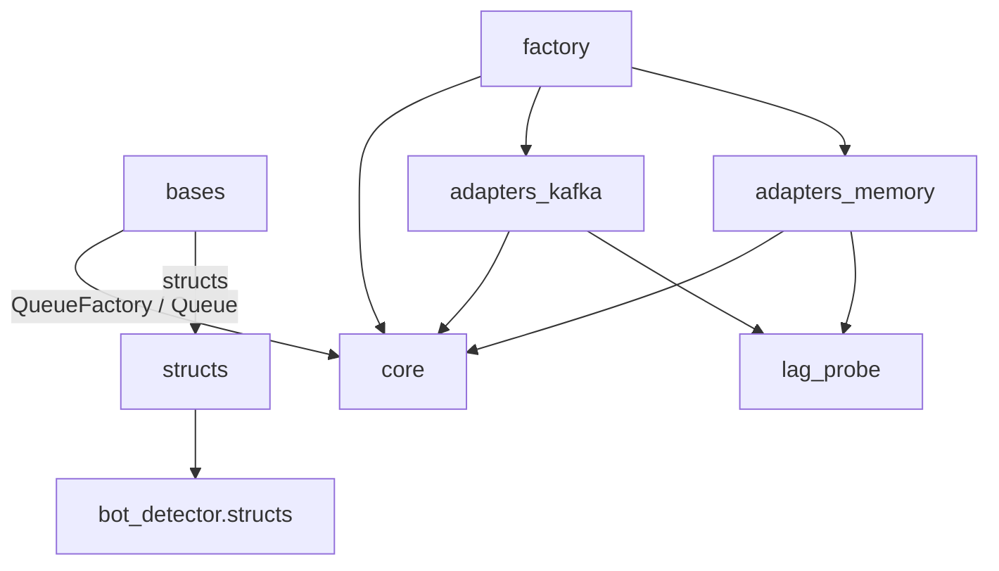

# event_queue

Reusable queueing component: typed produce/consume over swappable backends,
plus consumer-lag probes for throttling.

## Architecture overview

- `core/` — `Queue`/`QueueProducer`/`QueueConsumer` wrappers, backend
  `Protocol`s, domain errors, Prometheus metrics, `Batcher` (size/timeout
  batching). Backend-agnostic; the only transport concept is the protocol.
- `adapters/kafka/` — aiokafka adapters (producer, consumer, combined),
  pydantic configs, `KafkaLagProbe` (admin-API lag without group join).
- `adapters/memory/` — in-process `asyncio.Queue` adapters for tests and
  local runs; same protocols, no transport.
- `structs/` — pydantic message shapes (one per topic) and the hiscore
  activity-name mapper.
- `lag_probe/` — `LagProbeProtocol`.
- `factory.py` — `QueueFactory.create_queue` picks backend + queue shape at
  runtime; errors are returned as values, never raised.

Contract notes:

- `get_many` skips invalid records (poison bytes, schema drift) loudly:
  warn log + `event_queue_messages_skipped_total`. Offsets advance only on
  `commit()` after a successful batch, so skipping is how the consumer
  moves past poison instead of stalling forever.
- Kafka `put` uses `send_and_wait` (broker ack) with a capped retry/backoff.
- Invalid messages surface as error values from `get_one` on every backend.

## Dependency flow

Components must never import bases or frameworks; aiokafka is confined to
`adapters/kafka`.
