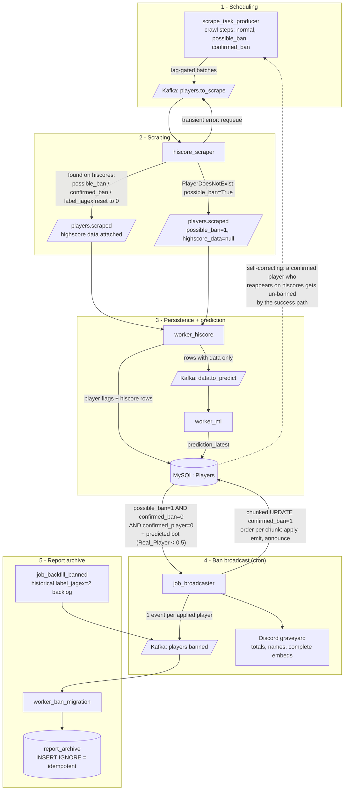

# Ban pipeline

How a player goes from "missing on the hiscores" to "confirmed bot, announced, reports archived".

## Step by step

1. **Scheduling** - `scrape_task_producer` pages through `Players` in three crawl steps (normal, possible_ban <= 7d, confirmed_ban <= 14d), throttled by `players.to_scrape` consumer lag, until it has covered the day and sleeps until tomorrow.

2. **Scraping** - `hiscore_scraper` fetches the hiscores page per player. A 404 (`PlayerDoesNotExist`) is the possible-ban signal: the processor publishes every outcome to `players.scraped` - with stats if found, with `highscore_data=null` + `possible_ban=True` if not found.

3. **Persistence** - `worker_hiscore` batches into MySQL: player flags via a temp-table UPDATE (guarded by `updated_at`, which the not-found path stamps), hiscore rows only when present. Rows *with* data continue to `worker_ml`, whose predictions land in `prediction_latest`.

4. **Broadcast** - the cron job reads one snapshot: pending possible bans that are predicted bots, excluding human-confirmed real players (`confirmed_player = 0`). Per chunk of 50: `UPDATE confirmed_ban = 1` (short PK transaction), publish one `players.banned` event per player, names embed to Discord. Totals embed first, role-pinged "Bans Added!" last.

5. **Report archive** - `worker_ban_migration` consumes the events and copies each banned player's report history into `report_archive`. `INSERT IGNORE` makes duplicate events harmless; `job_backfill_banned` keeps feeding the historical `label_jagex = 2` backlog through the same topic.

## Self-correction loop

If a confirmed bot resurfaces on hiscores, the success path resets all flags to 0 in MySQL, and the crawl scheduler naturally moves the player back to the normal step. A wrong ban fixes itself within one crawl generation; the archive row stays (harmless, source report rows are preserved).

## Dead path

`runemetrics_scraper` is undeployed (bricks kept in the repo for reference) and `players.not_found` has no producers - the topic stays defined but quiet. Jagex ban validation (`NOT_A_MEMBER`, `label_jagex = 2`) is no longer producible anywhere.
