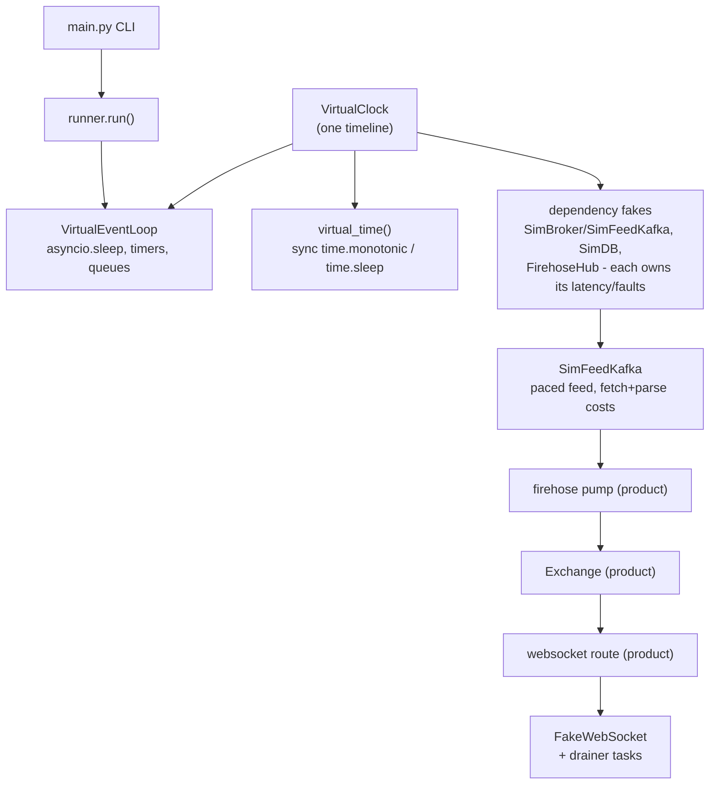

# DST: deterministic simulation toolkit

DST runs long-lived async systems in simulated time. A scenario that
covers a simulated day finishes in milliseconds of wall time. Every
run replays: the same seed and the same arguments give the same
result, down to individual messages, kicks, and close codes.

DST is a virtual clock plus dependency fakes. There is no shared
resource model: every latency, bandwidth, parse, and fault cost is
owned by the fake of the system that would pay it in production, so
a scenario models exactly the seams it exercises.

The toolkit lives at the repo root (`dst/`) and imports the product.
The product never imports DST.

## Layout

```
dst/                importable as `dst` (repo root is on pytest's pythonpath)
├── README.md
├── __init__.py
├── clock.py            VirtualClock: the one source of simulated time
├── loop.py             VirtualEventLoop: asyncio on the clock
├── timepatch.py        virtual_time(): sync time module patch
├── runner.py           run(): drive a scenario, return a SimResult
├── main.py             CLI launcher
├── testing.py          Scorecard, invariants, replay_check helpers
├── payloads.py         deterministic payload pools (ScrapedStruct / ToScrapeStruct)
├── faults.py           seeded fault draws and fault configs
├── systems/            simulated outside world
│   ├── sim_broker.py       SimBroker + SimFeedKafka: kafka log, paced feed,
│   │                       faults, fake-owned fetch/parse costs
│   ├── sim_costs.py        LinkCosts / CpuCosts: fake-owned link and cpu costs
│   ├── sim_db.py           SimDB: MySQL rowcount semantics over column stores
│   ├── db_faults.py        DB fault factories and FaultSession
│   ├── fake_firehose_clients.py  FirehoseHub / FirehoseFleet websocket fleet
│   └── seed.py             seeded row generators (players, reports, hiscores)
└── scenarios/          product-on-DST wiring, named <system|component|base>_<scenario>
    ├── kafka_smoke.py
    ├── kafka_drain_1m.py
    ├── firehose_parity.py
    ├── firehose_join_storm.py
    ├── firehose_keyed.py
    ├── firehose_reports_delay.py
    ├── db_insert_storm.py
    └── scraper_throughput.py
```

The repo root is on the import path for pytest (pytest.ini
`pythonpath`), so `import dst` resolves here. The scenario tests that
exercise it live in `test/sim/` and run nightly via
`.github/workflows/sim.yml` (`make test-sim`).

## Architecture



### How the parts work

- **VirtualClock** holds one float of seconds. `advance` moves by a
  relative amount. `advance_to` jumps to a deadline. Time never moves
  backwards.
- **VirtualEventLoop** subclasses `BaseSelectorEventLoop` and changes
  two things. `time()` reads the clock, so `asyncio.sleep(3600)` costs
  one O(1) clock jump. `_run_once` never polls for network events.
  When no callback is ready, it jumps the clock to the next timer.
- **DSTIdleError** replaces the blocked select. A task parked on a
  real socket, an unset future, or a missing simulated system can
  never proceed on a simulated timeline. The loop raises instead of
  waiting, so scenarios fail fast and name the cause.
- **Systems** stand in for the outside world and own their costs.
  Errors arrive as values, never as raises, and every draw is
  counter-based: `blake2b(seed, stream, ordinal)` via `dst.faults`,
  so interleaved surfaces never shift each other's outcomes.
  Scenario-local randomness (jagex latency draws, backoff jitter) is
  a seeded `random.Random`, seeded and restored around the run. The
  latency/bandwidth knobs live
  in the fakes: `LinkCosts` / `CpuCosts` in `dst/systems/sim_costs.py`
  (mean/jitter ms, bandwidth Mbps, seeded loss; cpu work as virtual
  sleeps plus a busy counter), the kafka fetch knobs on `KafkaConfig`
  (`fetch_mean_ms`, `fetch_jitter_ms`, `bandwidth_mbps`,
  `fetch_loss_pct`, `parse_cost_s`), and the DB pool/fault knobs in
  `SimDB` / `FaultSession`. A fake kafka returns broker errors,
  poison payloads, and slow fetches. The firehose fleet models
  fanout, grace drops, and kicks with close code 1013.
- **Scenarios** patch the I/O seams of a product and run the real code
  unmodified. The firehose_parity scenario replaces
  `QueueRepo.create_consumer` with the fake kafka and drives the real
  websocket route through `FakeWebSocket`. It never starts uvicorn
  and never opens a socket.
- **run()** ties it together. It builds the loop, runs the scenario,
  cancels leftovers, and returns a `SimResult` with virtual time, wall
  time, the return value, the error, and leaked task names.

## Usage

Run a scenario from the CLI:

```sh
# zero-wiring target: pure asyncio code
uv run python -m dst.main dst.scenarios.kafka_smoke \
    --kw duration_s=20 --kw feed_rate_s=250

# the real firehose app: 60 simulated seconds, 5 clients
uv run python -m dst.main dst.scenarios.firehose_parity \
    --kw duration_s=60 --kw feed_rate_s=500 --kw n_clients=5 --json-pretty
```

The target is `module[:function]`. The function defaults to `main` and
must be a coroutine function. `--kw k=v` values parse as JSON, with a
plain string as fallback. `--until` sets a virtual-time deadline for a
scenario that never ends on its own. Exit code is 0 only for a
completed scenario. Output is one JSON object.

Use the toolkit from a test:

```python
import dst

result = dst.run(my_scenario(), until_s=3600)
assert result.done
assert result.value.backlog > 0
```

## Scenarios

Scenario modules follow the naming convention
`<system|component|base>_<scenario>` (enforced by
`test/sim/test_scenario_naming.py`).

### firehose_parity - the real app, steady state

The production pump, exchange, and websocket routes on the clock.
Baseline for parity and capacity:

```sh
uv run python -m dst.main dst.scenarios.firehose_parity \
    --kw duration_s=60 --kw feed_rate_s=500 --kw n_clients=5 --json-pretty
```

### firehose_join_storm - staggered joins into a hot feed

Clients join one by one while the feed already runs at 1000 msg/s and
each client drains only 500 msg/s. Shows the join grace (drops) and
the kick rule (the pump protects a lone subscriber, two or more can
take kicks), and the resulting kick wave:

```sh
uv run python -m dst.main dst.scenarios.firehose_join_storm \
    --kw duration_s=75 --kw feed_rate_s=1000 --kw n_clients=5 \
    --kw join_interval_s=15 --kw client_slow_s=0.002 --kw client_buffer=500 \
    --kw kick_grace_s=10 --json-pretty
```

Expected shape: clients 0 and 1 take kicks around t=20 (grace over,
two subscribers), client 2 follows around t=45, later joiners ride out
the window as the lone survivor. Every victim still received real
service before the kick.

### firehose_keyed - per-user isolation from the anonymous crowd

Fast keyed clients (`key-<user>` tokens via a patched
`auth_repo.authenticate`) on their own consumer groups, next to a slow
anonymous fleet on the shared group. Proves the keyed users see their
full stream (no drops, no kicks) while the anonymous group degrades:

```sh
uv run python -m dst.main dst.scenarios.firehose_keyed \
    --kw duration_s=40 --kw feed_rate_s=200 --kw n_keyed=2 \
    --kw n_anonymous=3 --kw anonymous_slow_s=0.02 --kw kick_grace_s=10 \
    --json-pretty
```

Expected shape: keyed clients receive exactly the produced count of
their group with close 1000. Anonymous clients take kicks at the grace
edge, and the last survivor wins protection from the sole-subscriber
rule.

### firehose_reports_delay - the 2h emission delay over a full day

The reports.to_insert topic (keyed-only; the scenario injects a keyed
identity since it drives the route function directly) with the
product's real DelayAdapter. The broker produces fresh reports from
t=0, each ts generated on the spot and jittered 0..300s into the past.
The adapter locks on the first message, so the first ~2h are silent;
then the stream flows 2h behind arrivals, and at the end the last ~2h
sit in kafka:

```sh
uv run python -m dst.main dst.scenarios.firehose_reports_delay \
    --start 2000000000 --json-pretty
```

Defaults are the full shape: 24h window, 10 msg/s, 7200s delay, 300s
jitter. About a minute of wall time. `--start` must equal the epoch
base (default `2000000000`) because the hold compares report.ts
against the patched `time.time()`. Expected shape: first delivery at
~delay minus jitter, broker backlog at the end within a few percent of
delay x rate, `unstreamed_hours` about 2.

## Writing a scenario

1. Create a module under `dst/scenarios/` named
   `<system|component|base>_<scenario>.py`.
2. Expose `async def main(**kwargs)` that returns a pydantic report.
3. Patch each I/O seam of the product to a DST system.
4. Wind down: close sockets, stop feeds, then return the report.

Run it twice with the same arguments and compare the reports. Equal
reports prove the replay. A difference names the nondeterminism.

## Rules and known traps

- Construct the fakes, `FirehoseHub`, and scenario state inside the
  scenario coroutine. They bind to the clock of the running loop.
  Outside `dst.run`, pass a clock explicitly.
- The scenario body decides when `virtual_time()` applies. Product
  code that reads `time.monotonic` needs the patch active.
- Dataclass default factories capture the real `time.monotonic` at
  import time in a closure cell. `Inbox.subscribed_at` needed a cell
  rebind (see `_virtualize_inbox_clock` in the firehose_parity
  scenario). A grace window that never closes is the symptom.
- `SimFeedKafka.get_one` pays the fake-owned costs before the broker
  draw, so a faulted attempt costs one fetch; retries redraw (per-
  attempt ordinals), so faults never strand a cursor.
- One `virtual_time()` block at a time. The patch is global to the
  process. Nesting raises.

## Testing

```sh
uv run pytest test/sim -q
```

The sim suite is excluded from the default `uv run pytest` unit run
(pytest.ini testpaths) and from PR CI; it runs nightly and on demand
via `.github/workflows/sim.yml`.

The suite covers the clock, the loop, the systems, the launcher, the
naming convention, and every scenario. It asserts parity, ordering,
kick policies, fault replay, and end-to-end determinism of the
firehose_parity scenario.
